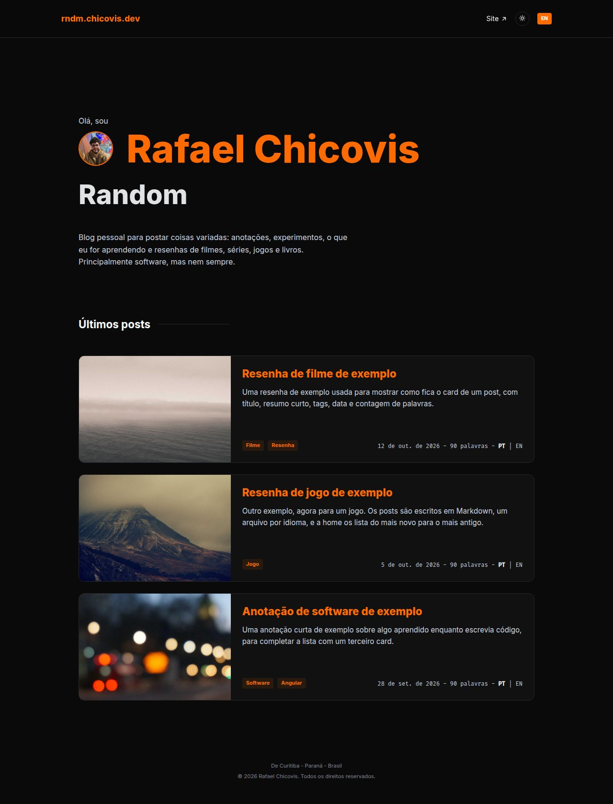
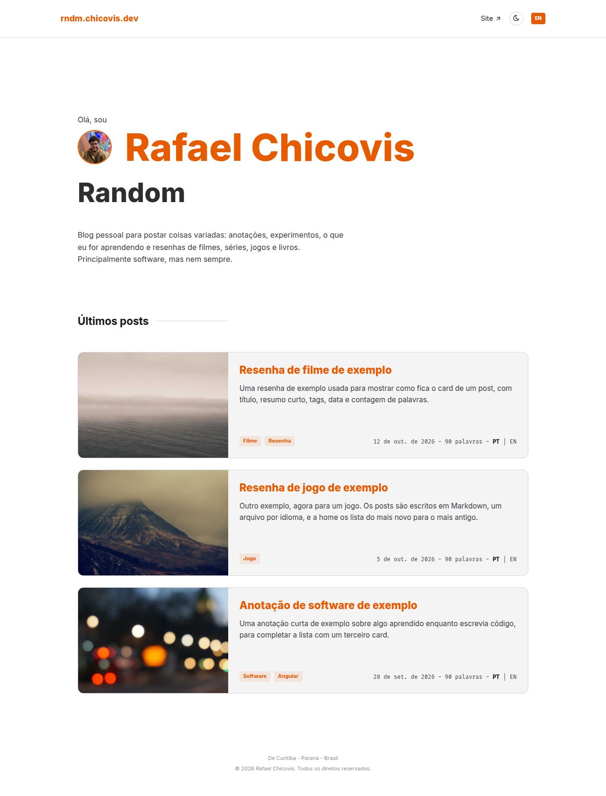
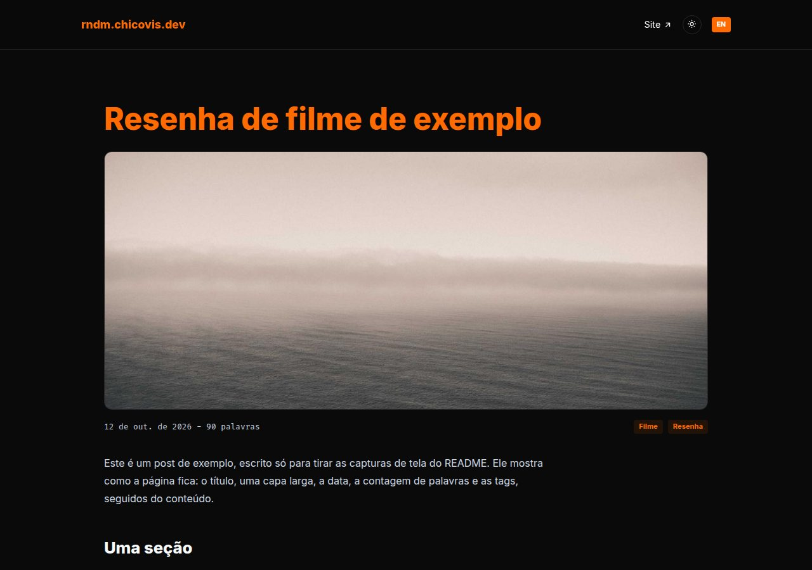
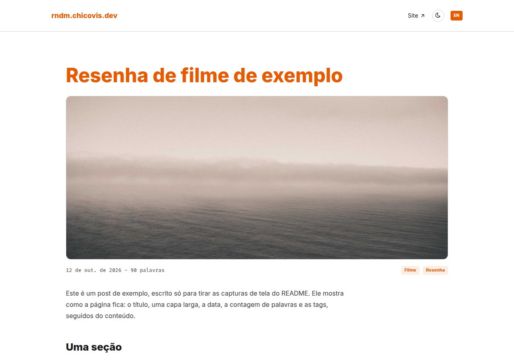

<div align="center">

[🇺🇸 English](README.md) | 🇧🇷 Português

# rndm

**Código-fonte do [rndm.chicovis.dev](https://rndm.chicovis.dev)**, "Random | Rafael Chicovis":<br>
um blog pessoal com anotações, experimentos e resenhas de filmes, séries, jogos e livros.

É o irmão do meu site pessoal, o [chicovis.dev](https://chicovis.dev), e compartilha o mesmo visual.

</div>

## Capturas de tela

### Home

| Tema escuro | Tema claro |
| :---: | :---: |
|  |  |

### Página do post

| Tema escuro | Tema claro |
| :---: | :---: |
|  |  |

## Recursos

- **Bilíngue** (`en` padrão, `pt`): o idioma faz parte da URL (`/en/...`, `/pt/...`), com alternativas `hreflang` para os buscadores ligarem as versões.
- **Temas escuro e claro**, salvos em um cookie compartilhado com o chicovis.dev.
- **Posts em Markdown**, uma pasta por post e um arquivo por idioma, com HTML puro permitido no meio do texto. Um post em um só idioma aparece para todo mundo, com um aviso.
- **Prerender estático**: cada página é gerada como HTML completo no build, sem servidor Node em produção.
- **SEO**: `title`, `description` e Open Graph traduzidos por página, URLs canônicas, JSON-LD `BlogPosting` e um `sitemap.xml` gerado a partir dos posts.
- **Acessibilidade em primeiro lugar**: HTML semântico, navegação por teclado, foco visível, contraste WCAG 2.2 AA e suporte a movimento reduzido.
- **Sem framework de CSS**: um design system pequeno (tokens e classes) copiado do site pessoal.

## Stack

- [Angular](https://angular.dev) 22: standalone components, signals, prerender estático com `@angular/ssr`
- [ngx-translate](https://github.com/ngx-translate/core) para os textos da interface
- [marked](https://marked.js.org) para renderizar os posts
- CSS puro com design tokens, webfont do [Tabler Icons](https://tabler.io/icons), fontes Inter e Fira Code
- [pnpm](https://pnpm.io), [Vitest](https://vitest.dev)

## Como começar

Requer Node ≥ 24.15 (ou ≥ 22.22.3) e [pnpm](https://pnpm.io).

```bash
pnpm install
pnpm start       # servidor de desenvolvimento em http://localhost:4200
pnpm build       # build de produção; site estático em dist/rndm/browser/
pnpm test        # testes unitários (Vitest)
pnpm posts       # valida os posts e regenera o índice de posts e o sitemap
```

Use sempre os scripts do pnpm (e não `ng serve`/`ng build` diretos): eles rodam o `pnpm posts` antes.

## Escrevendo um post

Cada post é uma pasta em `src/content/posts/<guid>/`:

```
<guid>/
  manifest.json   # título, resumo, capa, tags, data, availableLangs (textos por idioma)
  en.md           # o post em inglês
  pt.md           # o post em português
  assets/         # capa e imagens, referenciadas no Markdown como assets/<arquivo>
```

O jeito mais fácil de criar um é o **skill `/new-post`** do [Claude Code](https://claude.com/claude-code) (`.claude/skills/new-post/`): ele explica cada arquivo e campo, usa os modelos, cria a pasta e valida. Um post novo não precisa de mais nada: a página, o SEO, o prerender e a entrada no sitemap são automáticos.

## Estrutura do projeto

```
src/
  styles.css          # design tokens, temas, classes utilitárias e de componentes
  index.html          # SEO base, JSON-LD, inicialização do tema
  app/
    core/             # serviços de tema, idioma, cookie e SEO, guards de rota
    i18n/             # dicionários en/pt e configuração do ngx-translate
    layout/           # header e footer
    pages/            # páginas da home e do post
    posts/            # modelo do post, renderização do Markdown, resolver, lista e card
    shell/            # layout da página
  content/posts/      # os posts (Markdown)
scripts/              # validação dos posts, índice de posts e geração do sitemap
.claude/skills/       # o skill /new-post
public/               # robots.txt, sitemap.xml (gerado), favicon
```

## Convenções

- Tudo no repositório é escrito em inglês (código, comentários, docs); os textos visíveis ao usuário são localizados em `src/app/i18n`. A única exceção é este [README.pt-BR.md](README.pt-BR.md).
- A estilização usa apenas os tokens e classes de `src/styles.css`.
- Acessibilidade e SEO são requisitos de primeira classe.

Veja o [CLAUDE.md](CLAUDE.md) para as diretrizes completas de design system, acessibilidade e SEO, e o [ROADMAP.md](ROADMAP.md) para o passo a passo do projeto.
