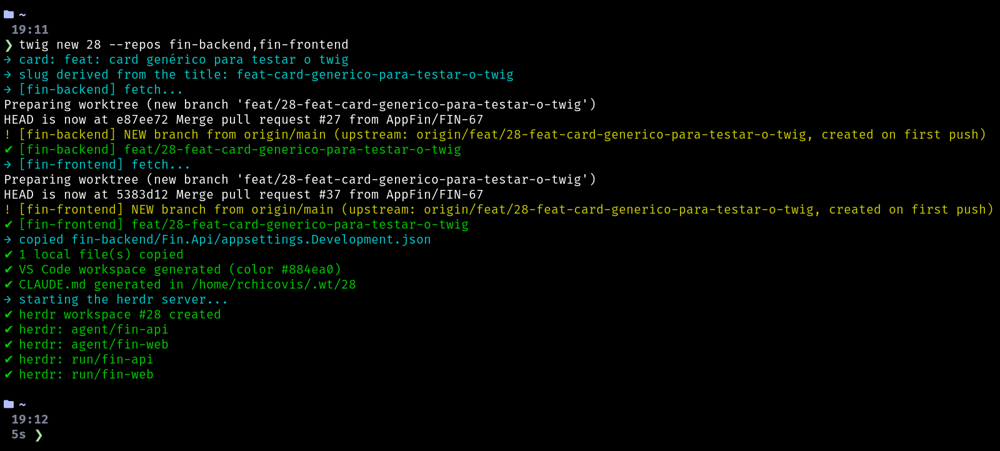
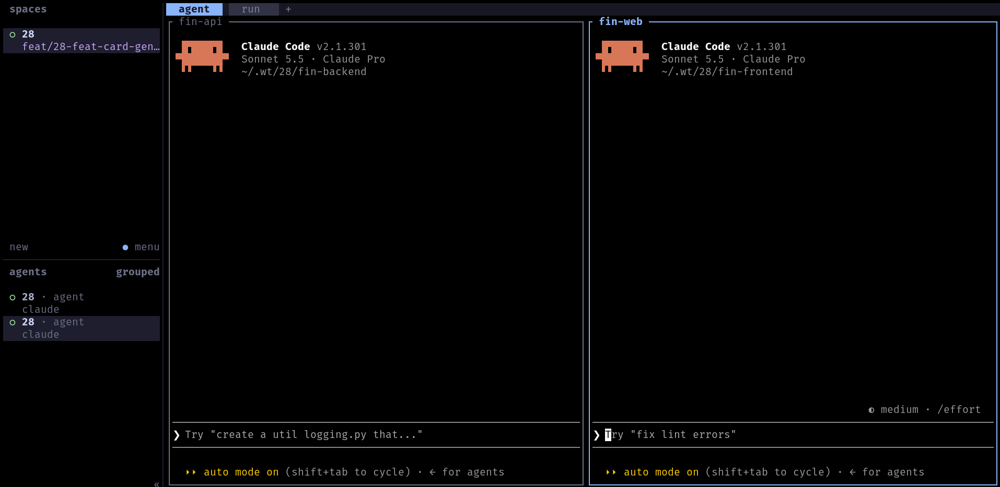
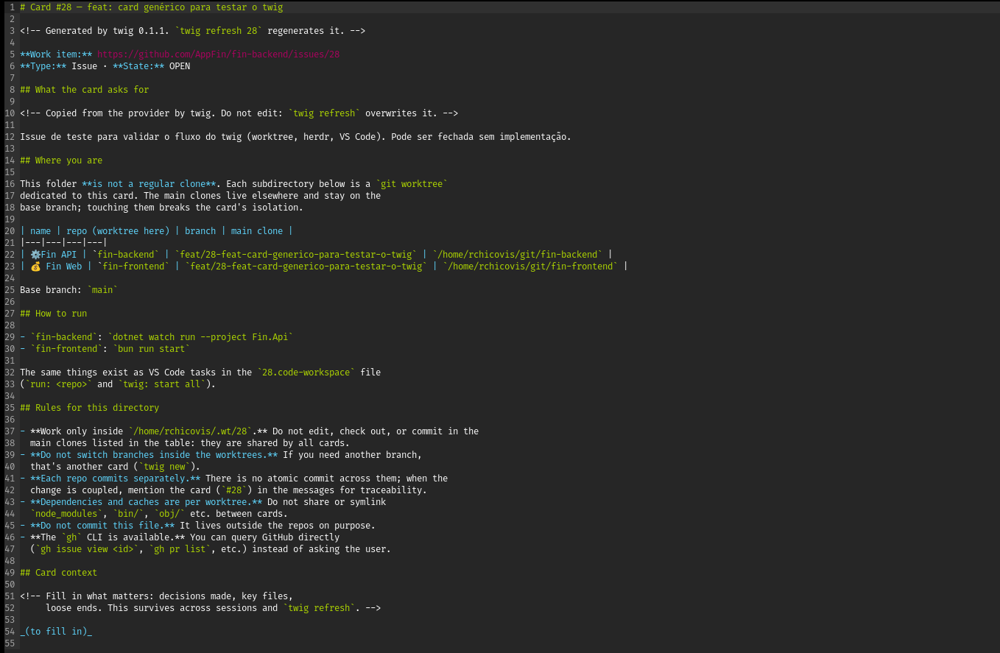
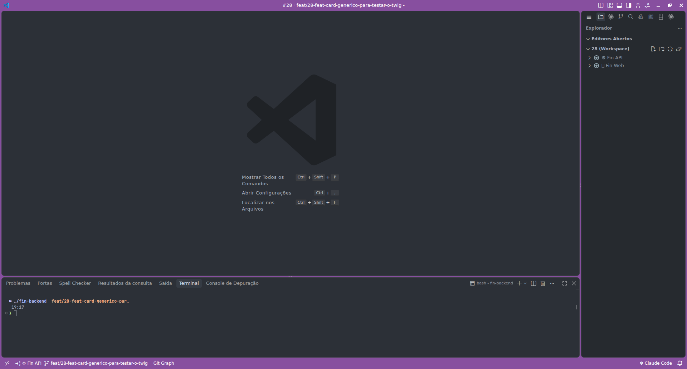
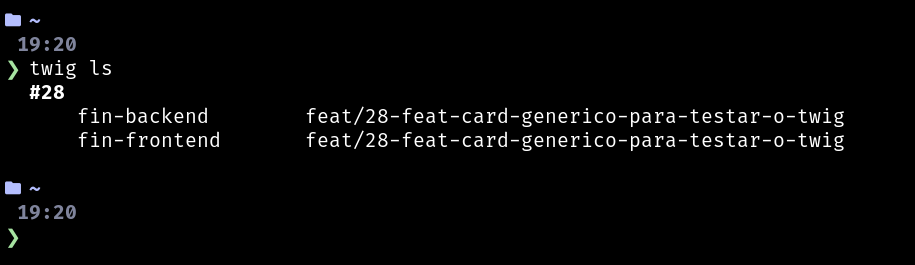

`twig` is a small command-line tool I wrote to stop juggling branches. You give it a card number, and it builds an isolated environment for that task: one git worktree per repository, an AI agent per repo and a VS Code workspace, all ready to work.

It is open source: [github.com/RafaelKC/twig](https://github.com/RafaelKC/twig).

## The problem

A real task rarely lives in a single repository. The back end, the front end and a shared library change together. And when I switch branches in my main clones to work on a second task, I break everything that is running for the first one: dev servers restart, builds fail, half-finished changes get in the way.

I wanted every card to have its own sandbox, and I wanted creating it to cost one command, not ten minutes.

## The idea

Each card (an Azure DevOps work item or a GitHub issue) gets a folder with a [git worktree](https://git-scm.com/docs/git-worktree) of every repo it touches:

```
~/.wt/52644/
├── api/                    git worktree on the card's branch
├── web/                    git worktree on the card's branch
├── CLAUDE.md               the card's title, description, acceptance criteria, repos and rules
├── 52644.code-workspace    VS Code workspace, colored per card
└── .ado.json               cached work item
```

My main clones stay on `main` and are never touched. Two cards never step on each other.

## Creating a card

```bash
twig new 52644
```

twig reads the card from Azure DevOps (`az`) or GitHub (`gh`), picks the branch for each repo and sets everything up. The branch is an existing `origin` branch with the card number in its name, or a new `feat/52644-vehicle-category-per-route` (`fix/` for bugs), with the slug taken from the card's title.

<!-- IMAGE 1: terminal with the output of `twig new <id>` (cards, branches, workspace created). File: assets/01-twig-new.png -->



Gitignored files that you need to run the project (`appsettings.Development.json`, `.env.local`...) are copied from the main clone into each worktree, so the card starts in a working state.

## An agent per repo, in herdr

The part I like the most. I found out about herdr through my friend [Luis Otavio](https://blog.wired.rs/), and it changed how I work with agents. twig opens a workspace in [herdr](https://herdr.dev) with two tabs:

- **agent**: one pane per repo, each one running the AI agent (Claude Code, in my case) inside that repo's worktree;
- **run**: one pane per repo that starts the project (`pnpm start`, `dotnet watch run`...).

<!-- IMAGE 2: herdr with the card's workspace: `agent` tab with two panes (one per repo). File: assets/02-herdr-workspace.png -->



Closed a pane by accident? `twig add-repo` brings it back, and it is also how you add another repo to a card later.

## The card context for the agent

Inside the card folder, twig generates a `CLAUDE.md` with the title, state, description and acceptance criteria of the card, the repos, the branches and the rules. The agent starts already knowing what the task is. There is also a "card context" section for notes that survives regeneration, so a new session picks up where the last one stopped.

<!-- IMAGE 3: the generated CLAUDE.md of a card open in an editor (hide any private data from the card). File: assets/04-card-claude-md.png -->



## A VS Code workspace with a color

twig also generates a `.code-workspace` with friendly folder names, a title bar color that is different for each card (so I never edit the wrong window), `run:` tasks and a debug compound that starts every repo at once.

<!-- IMAGE 4: VS Code with a card's workspace: colored title bar and the folders of the repos in the explorer. File: assets/03-vscode-workspace.png -->



```bash
twig code        # opens the current card in VS Code
```

## Day to day

```bash
twig ls                         # cards, branches and uncommitted changes (*)
twig herdr 52644                # open the card in herdr
twig refresh 52644 --refetch    # regenerate CLAUDE.md / workspace, refetch the card
twig rm 52644 --branches        # done: remove the worktrees and local branches
twig doctor                     # check tools, logins, config and repos
```

<!-- IMAGE 5: terminal with the output of `twig ls` showing a few cards. File: assets/05-twig-ls.png -->



`twig rm` refuses to remove a card that has uncommitted changes, and `twig doctor` also finds orphaned worktrees.

## Configuration

Everything specific to my setup lives in one file, `~/.config/twig/config.toml`:

```toml
version = 1

[provider]
default = "az"                      # or "gh"

[paths]
worktrees = "~/.wt"
repos     = "~/dev"

[repos.api]
label   = "⚙️ API"                  # VS Code folder name
short   = "api"                     # herdr pane name
default = true                      # part of every new card
run     = "dotnet watch run --project src/Api"
install = "dotnet restore"

[repos.web]
label   = "🌐 Web"
default = true
run     = "pnpm start"
```

Every field is documented in the [config reference](https://github.com/RafaelKC/twig/blob/main/docs/CONFIG.md).

## A skill for the agent

twig ships with a [skill](https://github.com/RafaelKC/twig/blob/main/skills/twig/SKILL.md) for AI agents. With it, I can just say "start card 52644" or "I'm done with card 52644" and the agent runs the right commands. When it is inside a card folder, it reads that card's `CLAUDE.md` before doing anything else.

## Installing

Linux (x86_64 and arm64, including WSL) and macOS (Intel and Apple Silicon):

```bash
curl -fsSL https://rndm.chicovis.dev/twig/unix-install | sh
```

The installer checks and installs the dependencies (git, herdr, `az` or `gh`, Claude Code and, optionally, VS Code), downloads the release for your system, verifies its checksum and Sigstore signature, and installs twig, the skill, the herdr plugin and the shell completions. Running it again updates. After that:

```bash
twig config edit
twig doctor
```

The short URL is just a redirect to the installer of the latest release on GitHub, so you can read it before running it, which I recommend for anything you pipe into `sh`.

## Next steps

What is on the [roadmap](https://github.com/RafaelKC/twig/blob/main/docs/ROADMAP.md), roughly in the order I want it:

- **Ports per card**, so two cards can run their apps at the same time, with the front end pointing at the back end of the same card. For that, twig needs to recognize the project type (.NET, Angular, Node, Vite...) and know where to set the port.
- **More herdr actions**: open the card or its pull request in the browser, close a card from herdr, show the card status in the sidebar and get a notification when an agent is blocked waiting for me.
- **Pull request review in the terminal**, with [herdr-reviewr](https://github.com/persiyanov/herdr-reviewr): a worktree created from the PR branch, comments per line, and the agent posting them inline on the PR.
- **Pull request info from the provider**: status and link of the card's branch PR.
- **Native Windows**. Today it works through WSL; the native version waits for herdr's Windows support to leave beta.
- **Quality**: integration tests for `new`, `add-repo` and `rm`, CI on pull requests and testing on macOS.
- **A final name**: `twig` is still provisional.

## Status

It is early and it fits my workflow: Azure DevOps or GitHub, git, herdr and Claude Code. If it fits yours too, or you want to change something, the [repository](https://github.com/RafaelKC/twig) is open for issues and pull requests.
