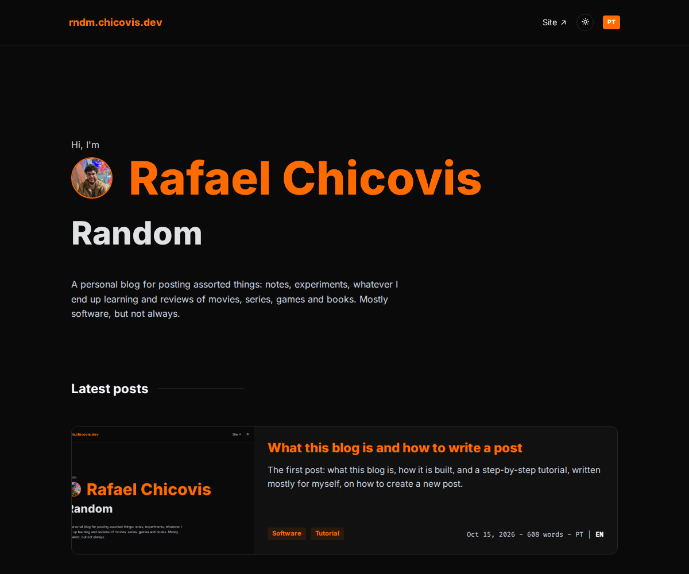
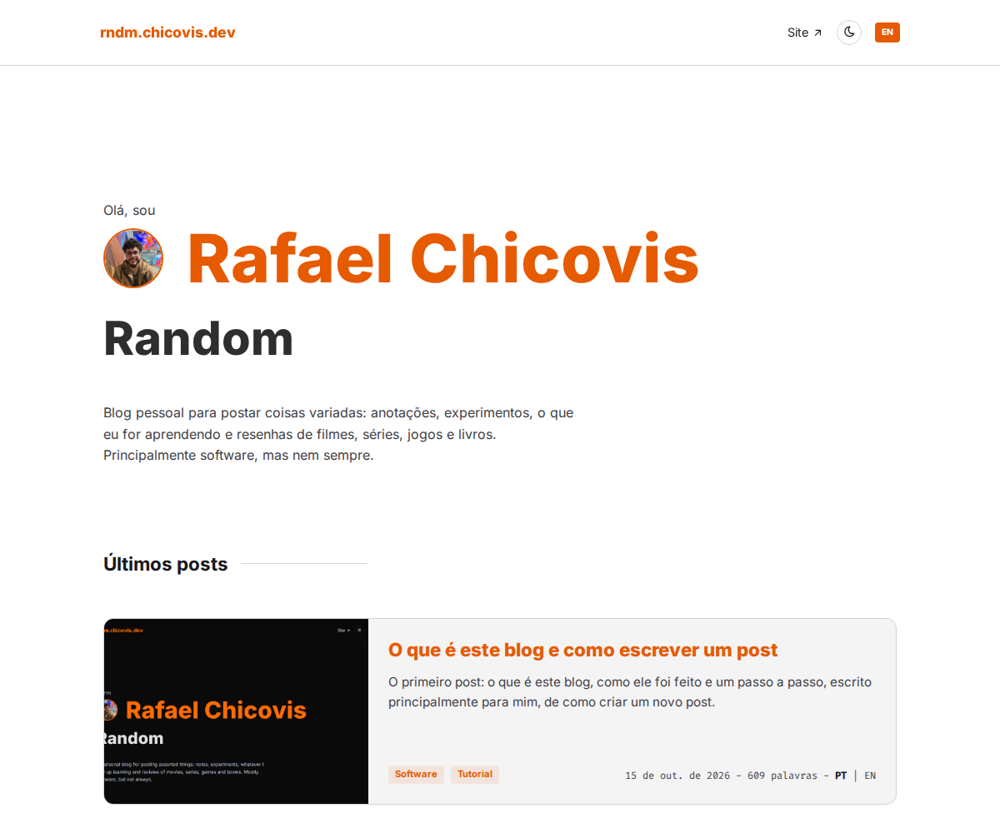
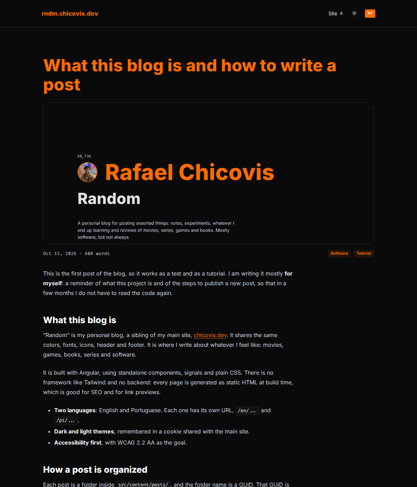

This is the first post of the blog, so it works as a test and as a tutorial. I am writing it mostly **for myself**: a reminder of what this project is and of the steps to publish a new post, so that in a few months I do not have to read the code again.

## What this blog is

"Random" is my personal blog, a sibling of my main site, [chicovis.dev](https://chicovis.dev). It shares the same colors, fonts, icons, header and footer. It is where I write about whatever I feel like: movies, games, books, series and software.

It is built with Angular, using standalone components, signals and plain CSS. There is no framework like Tailwind and no backend: every page is generated as static HTML at build time, which is good for SEO and for link previews.

- **Two languages**: English and Portuguese. Each one has its own URL, `/en/...` and `/pt/...`.
- **Dark and light themes**, remembered in a cookie shared with the main site.
- **Accessibility first**, with WCAG 2.2 AA as the goal.





## How a post is organized

Each post is a folder inside `src/content/posts/`, and the folder name is a GUID. That GUID is the post id and also its URL: `/en/post/<guid>`. It must never be renamed after publishing.

```text
src/content/posts/<guid>/
  manifest.json   title, summary, cover, tags, date, availableLangs
  en.md           the post in English
  pt.md           the post in Portuguese
  assets/         cover and images
```

The `manifest.json` holds the metadata. Every text in it is an object with one entry per language, for example `{ "en": "...", "pt": "..." }`. The `wordCount` field stays as `{}`, because it is calculated automatically.

The Markdown files hold only the body. The title comes from the manifest and is the page `h1`, so headings inside the Markdown start at `##`.

<!-- SCREENSHOT 3: the post folder open in the editor -->

## Creating a new post

I do not do this by hand. The project has a Claude Code skill for it.

1. Open the project in the editor and run `/new-post` in Claude Code, followed by a short description of the post: topic, languages, tags and cover.
2. The skill creates a new GUID folder, downloads or copies the cover, fills the manifest and writes the Markdown from the templates.
3. It runs `pnpm posts`, which validates everything and fails with a clear message if something is missing.
4. I start the app with `pnpm start`, check the post on the home page and on its own page, and fix what I do not like.

<!-- SCREENSHOT 4: the /new-post command in the Claude Code terminal -->

If I ever need to do it manually, the steps are the same: generate a GUID with `node -e "console.log(crypto.randomUUID())"`, create the folder and its `assets/` subfolder, copy the templates from `.claude/skills/new-post/templates/`, fill them in and run `pnpm posts`.

## Adding images

Images go into the post's `assets/` folder and are referenced from the Markdown with a relative path. The alt text is required, because it is what screen readers announce.

```md

```

## Previewing and publishing

- `pnpm start` runs the dev server. After adding a post, restart it so the home list is regenerated.
- `pnpm build` makes the production build, with every page prerendered.
- `pnpm posts` validates the posts and regenerates the index and `public/sitemap.xml`. The sitemap changes with every new post, so it is committed together with it.



## Editing a published post

Change the `.md` file, set `updated` in the manifest to the current date and run `pnpm posts` again.

## About this post

This is the very first post, and it was written as a tutorial for my future self. The screenshots of the project are already here; the ones of the editor and of the terminal are still missing. If you are not me and ended up here anyway, welcome, and I hope it was at least a bit useful.
