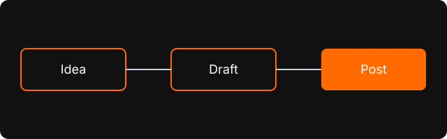

This is the first post on **Random**, and mostly a test drive. It exists to check that everything a post needs works: text, lists, code, images and a bit of raw HTML in the middle of the Markdown.

## What this blog is

A place to write down whatever I feel like: notes, experiments, things I'm learning, and reviews of movies, series, games and books. Mostly software, but not always.

> Writing is how I find out what I actually think.

## How a post is made

Each post lives in its own folder, with one Markdown file per language and a manifest with the metadata:

- `manifest.json`: title, summary, tags, date and word count
- `pt.md` and `en.md`: the content, in each language
- `assets/`: the images used by the post



If a post exists in only one language, that is the one you get.

## Code works too

```ts
const greeting = (name: string) => `Hello, ${name}!`;
console.log(greeting('Random'));
```

Inline code like `pnpm build` is fine as well, and so are tables:

| Type | Example |
| --- | --- |
| Movie | A review |
| Game | Another review |

## Raw HTML in the middle

Markdown can carry plain HTML when it needs more control. Press <kbd>Ctrl</kbd> + <kbd>K</kbd>, highlight a <mark>key phrase</mark>, or hide something behind a toggle:

<details>
  <summary>Click to expand</summary>
  <p>This block is written in HTML, right in the middle of the Markdown file.</p>
</details>

<figure>
  
  <figcaption>An image with a caption, using <code>&lt;figure&gt;</code>.</figcaption>
</figure>

That's it. More soon.
